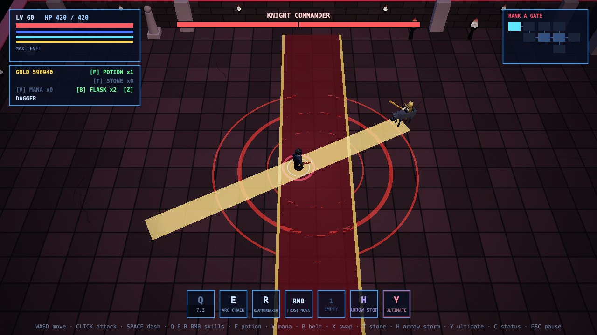

# Untitled Levelling Game

[](https://tandexun.dev/gatebound/)
[](https://github.com/tandx28/gatebound/actions/workflows/deploy.yml)
[](LICENSE)

**A free, open-source 3D action RPG that runs in your browser.** You are the
lowest-ranked hunter in the city of Veyra. A gate goes wrong, you should have
died, and you wake with your name entered in the Ledger: a system only you can
see, which rewards progress and punishes failure.

### ▶ [Play it now](https://tandexun.dev/gatebound/) — no download, no account

Desktop browser with keyboard and mouse. Progress saves in your browser.



## Why play it

- **Hard but fair.** Three hits kill a fresh hunter, and every attack is
  telegraphed on the floor before it lands.
- **Level from nothing.** Ranks E to S, levels to 60, gear in six rarities with
  random perks, nine mythics earned only by deeds, each with its own ultimate.
- **Raise an army.** Bind the enemies you kill, bosses included, as echoes
  that fight beside you.
- **Four classes, twenty skills, five weapon types**, each with its own look and
  effects.
- **Endless after the story:** New Game+, Nightmare, the Tower, a Time Trial,
  a Boss Rush, and a secret boss for those who read the margins.
- **Everything is made in code:** the levels, the music, the sound, most of
  the art. The whole game is about 6 MB.

## Everything in it

- Real-time combat in 3D: five weapon types, two weapon slots, a dash with
  invulnerability, twenty skills in a loadout of up to seven. Heavy blows stagger.
- Gates of rank E to S, each a generated set of rooms ending in a boss with
  phases. Rooms have pillars to fight around and traps in the floor that
  hurt whoever stands on them. Hard from the first room: three hits kill a
  fresh hunter. A new game's first gate explains itself, one tip a room.
- Sealed gates, lit red: no way out, a boss already awake with guards, and a
  prize. One stands on the board each day, and one gate in six is sealed.
- Five stats, levels to 60, equipment in six rarities with random perks,
  eight mythics earned only by deeds, titles, potions and a flask.
- A daily quest, and a penalty zone if you miss it.
- Emergency quests, a hidden trial, key dungeons, gate breaks.
- The Rite of Echoes: after it, the enemies you kill, bosses included, can
  be bound to fight beside you, ordered to hunt, guard or hold, sent away
  and called back.
- Four classes, chosen on the Hunter tab once the rite is done, each with its
  own power on H: Echo Caller (the army), Vanguard (Bulwark), Ranger (Arrow
  Storm) and Arcanist (Overflow, from New Game+ 1).
- Twenty skills on four pages of the Skills tab: blade, guard, arcane, echo,
  each with its own effect (a falling star, rock spikes, chain lightning...).
- Five weapon types: dagger, sword, spear, bow (hold to draw; a full draw
  looses a piercing charged shot) and staff (bolts that burst, shaped by the
  staff's element: fireball, ice shard, lightning, plain light).
- Every named weapon has its own model and its own glow (steady, pulsing,
  flickering, runes that light in turn, or a ripple); mythics have parts that
  circle on their own. The shop and gear tabs show the weapon under the
  cursor, turning, beside its name.
- The bag on the shop and gear tabs can be filtered by kind (weapons, armour,
  accessories) and by rarity, and sorted by newest, rarity, name or kind.
- Crit chance stops at 60%; anything past that becomes extra crit damage.
- Every mythic has an ultimate on Y that recharges over 90 s, faster with kills.
  Wearing more than one mythic, choose which ultimate Y uses on the gear tab.
  Point at a mythic on the shop or gear tab to read what its ultimate does;
  SEE ULTIMATE plays it as a short scene on a ring of targets (Space, Enter or
  a click returns to the board; nothing is won or lost, the cooldown is kept).
- Rooms vary: drums, broken columns, obelisks and statues; piers, chained and
  broken piers, pedestals; stalagmites, crystal spires and stacked boulders;
  low walls and groves of slender pillars; cracks, rugs, grave slabs, grates,
  pools and candles on the floor.
- Legendary and mythic gear wears an aura by its perks.
- A Bestiary tab: kills per enemy kind, lore at 10 kills, and +10/20/30%
  damage against that kind at 50, 150 and 500 (bosses need a tenth).
- Special gates (sealed, gate break, emergency, hidden door, the trials) open
  with a short scene the first time, then a title card.
- A secret, for those who finish the story: five struck lines, a riddle, and
  something waiting in the margin.
- A story in six chapters with in-engine cutscenes and two endings. Hold Esc
  for two seconds to skip a scene; replay any of them from the Story tab.
- Bosses pass through stages as they weaken, gaining new attacks: quakes,
  rings of bolts, crossing lines of blasts, falling fire, called guards.
- After the story: New Game+ (three cycles, everything kept, stronger
  gates, one more skill slot and a title each cycle), then Nightmare. The
  Trials tab holds the Tower (an endless climb), the Time Trial (the tower
  against a clock) and the Boss Rush (every master at Rank S, timed).
- Every key can be moved (System, or the pause menu: Controls).
- Generated music with its own song per gate, and synthesised sound effects.
- Progress saves in the browser. Saving inside a gate resumes at the room.

## Controls

| Key | Action |
| --- | --- |
| W A S D | Move |
| Mouse | Aim |
| Click | Attack |
| Space | Dash |
| Q E R, right click | Skills |
| 1 2 3 | Extra skill slots, opened by New Game+ 1, 2 and 3 |
| F | Potion |
| V B Z | Mana draught, belt item, next belt item |
| X | Swap weapon |
| T | Return Stone: leave the gate |
| G | Bind a remnant (after the rite) |
| H | Class power: send echoes away or call them back (Echo Caller), Bulwark, Arrow Storm, Overflow |
| Y | Mythic ultimate |
| J | Army orders: hunt, guard, hold |
| C | Status and stat points |
| Esc | Pause, save, settings |

## Run it locally

Needs Node 20.19 or later (or Node 22.12+).

```bash
npm install
npm run dev
```

Other commands:

```bash
npm test          # unit tests
npm run build     # static build in dist/
npm run balance   # bot-played difficulty report
```

## How it is built

TypeScript, Vite and Three.js. The game itself is a pure simulation on a flat
plane (`src/game`), stepped at a fixed 120 Hz and covered by more than 670
unit tests; it knows nothing about rendering or audio. The 3D view
(`src/render/scene3d.ts`), the 2D overlay (`src/render/hud.ts`) and the audio
(`src/audio`) only read its state. Difficulty is tuned against a scripted
player (`src/game/balance`) that plays every rank. Every push to `main` is
tested and deployed by GitHub Actions. [CLAUDE.md](CLAUDE.md) is the full map
of the code and its rules.

## Contributing

Bug reports, ideas and pull requests are welcome; see
[CONTRIBUTING.md](CONTRIBUTING.md). Found a security problem? See
[SECURITY.md](SECURITY.md).

## Licence

The code is under the [MIT licence](LICENSE). The character models are CC0
(see Credits).

## Credits

Made by [Tan De Xun](https://tandexun.dev). Character models: KayKit
Character Packs (Adventurers, Skeletons) by Kay Lousberg, CC0. See
`public/models/LICENSE.txt`.
